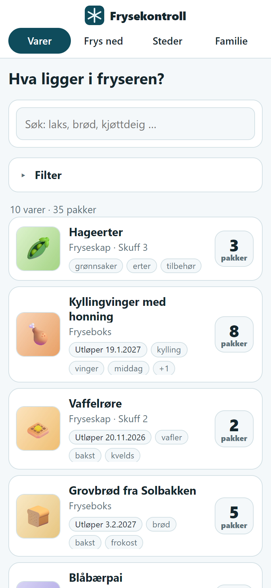
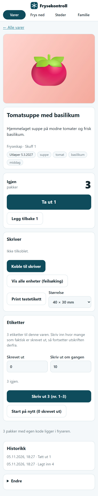
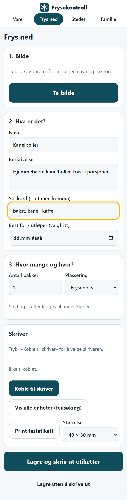
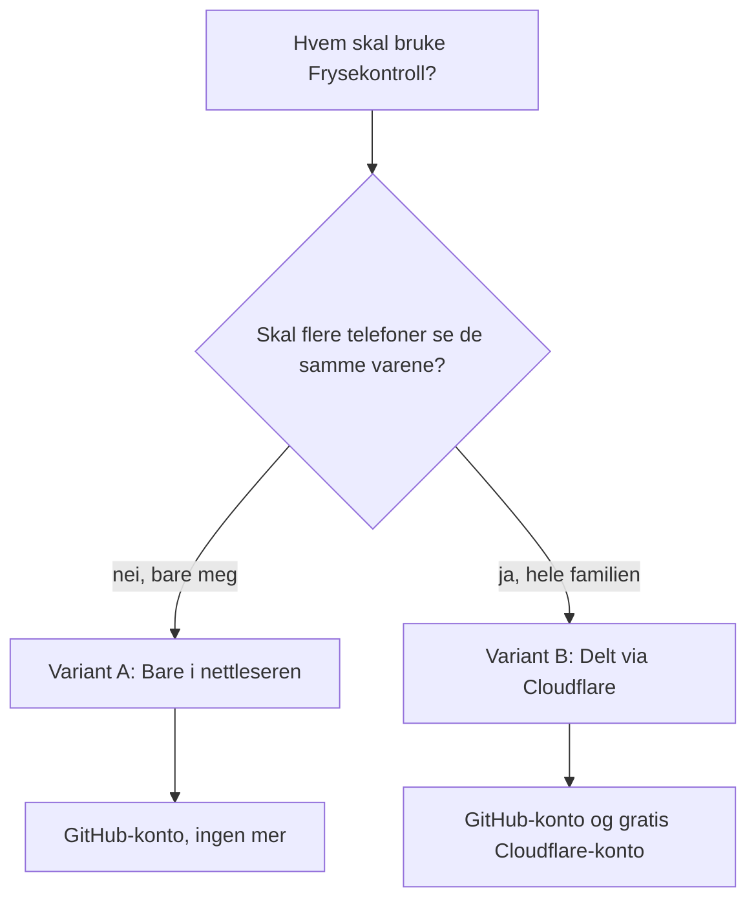

# Frysekontroll

Hva ligger i fryseren, og hvor? Ta bilde av maten, skriv ut en etikett med QR-kode på en liten etikettskriver, legg den i fryseren, og skann koden når du tar maten ut. Antallet telles ned av seg selv.

Du trenger ikke kunne programmere. Du klikker deg gjennom noen få trinn, så har du din egen Frysekontroll. Det er gratis å sette opp (se «Hva koster det?» nederst).

**Usikker på hvor du skal starte? Bruk veiviseren:** https://saysphilippe.github.io/Frysekontroll-pakke/start.html. Den stiller noen få spørsmål og gir deg riktige trinn for akkurat deg.

| Varelisten | Én vare | Frys ned |
|---|---|---|
|  |  |  |

Alle varene på bildene er oppdiktede.

## Hva kan den?

- **Varelisten** med bilde, sted, utløpsdato og antall pakker. Søk i navn og stikkord, og filtrer på fryser, skuff, stikkord og utløp. Utløpte pakker merkes «Utløpt».
- **Frys ned:** ta bilde, skriv navn (eller la bildetolkingen foreslå det i den delte varianten), velg antall pakker og hvor de skal ligge.
- **Én etikett per pakke**, hver med sin egen QR-kode. Skanner du koden, åpnes akkurat den pakken, og den kan bare tas ut én gang.
- **Ta ut og legg tilbake**, med historikk over hva som skjedde.
- **Steder:** legg til og fjern frysere og skuffer.
- **Etiketter i omganger:** skal du skrive ut 45 etiketter, skriver appen for eksempel ti om gangen. Du sier selv hvor mange som faktisk kom ut, og neste omgang starter derfra. Skjermen holdes våken mens det skrives ut.
- **Print testetikett** og **Vis alle enheter (feilsøking)** hjelper deg å få kontakt med skriveren og se at størrelsen stemmer.

## Hva trenger du?

**Alltid**
- En etikettskriver av typen **Niimbot B21**, og etiketter til den. Etiketter på 40 × 20 mm er det appen kjenner best, men flere størrelser kan velges i appen. Har du skriveren, har du alt du trenger av utstyr.
- En telefon. På **Android** bruker du Chrome. På **iPhone** bruker du appen **Bluefy**, siden Safari ikke kan snakke med skriveren. Firefox virker heller ikke.
- Skriveren kobles til med Bluetooth fra nettleseren. Ingen egen skriverapp trengs.

**Avhengig av hva du velger**
- En gratis **GitHub-konto** (begge variantene).
- En gratis **Cloudflare-konto** (bare den delte varianten).

## Velg: bare du, eller hele familien?

Den raskeste veien er [veiviseren](https://saysphilippe.github.io/Frysekontroll-pakke/start.html). Vil du heller lese selv, er valget slik:



| | **A. Bare i nettleseren** | **B. Delt via Cloudflare** |
|---|---|---|
| Hvem bruker den | Én telefon | Hele familien, flere telefoner |
| Hvor ligger varene | I nettleseren på telefonen | I en database hos Cloudflare |
| Passord | Ingen | Felles passord, og eget passord per person |
| Bildetolking (bildet blir navn og søkeord) | Nei, du skriver selv | Ja |
| Konto du må ha | GitHub | GitHub og Cloudflare |
| Sikkerhetskopi | Du laster ned selv (siden «Kopi») | Ligger i databasen |

Er du i tvil: start med A. Den er raskest. Du kan flytte til B senere, men da må varene legges inn på nytt.

## Variant A: Bare i nettleseren (GitHub Pages)

Tar ca. fem minutter. Du trenger en GitHub-konto.

1. Trykk **Use this template → Create a new repository** øverst på denne siden. Velg et navn og la det stå som offentlig (GitHub Pages krever det på gratiskontoer). Repoet inneholder ingen varer eller personlige opplysninger. Varene dine lagres bare på telefonen.
2. I ditt nye repo: **Settings → Pages → Source: GitHub Actions**.
3. Gå til fanen **Actions**. Vent til «Publiser på GitHub Pages» har et grønt merke. Første gang kan du måtte trykke **Run workflow**.
4. Adressen står under **Settings → Pages**, og ser slik ut: `https://ditt-brukernavn.github.io/repoets-navn/`. Åpne den på telefonen.
5. Legg den på hjemskjermen (Del-menyen i Bluefy eller Chrome → «Legg til på hjemskjerm»).

Husk:
- Varene ligger **bare i nettleseren på den ene telefonen**. Tømmer du nettleserdata eller bytter telefon, er de borte. Gå til **Kopi** i menyen og last ned en sikkerhetskopi av og til. Der kan du også gjenopprette en kopi.
- Bruker du iPhone: legg appen på hjemskjermen. Nettleseren kan ellers rydde bort data etter en tid uten bruk.
- QR-kodene på etikettene peker på adressen over. Flytter du siden til en annen adresse, må etikettene skrives ut på nytt.

## Variant B: Delt via Cloudflare

Tar ca. ti minutter. Du trenger en GitHub-konto og en gratis [Cloudflare-konto](https://dash.cloudflare.com/sign-up).

1. Trykk knappen:

   [](https://deploy.workers.cloudflare.com/?url=https://github.com/saysphilippe/Frysekontroll-pakke)

2. Logg inn på Cloudflare, og la den kopiere prosjektet til din GitHub-konto når den spør.
3. Cloudflare spør etter **FRYS_PASSWORD**. Det er det felles passordet familien bruker for å komme inn. Velg et langt passord og skriv det ned.
4. Trykk **Deploy**. Cloudflare lager databasen og publiserer appen. Det tar et par minutter.
5. Adressen står i Cloudflare når den er ferdig: `https://frysekontroll.<ditt-navn>.workers.dev`. Åpne den på telefonen og logg inn med passordet.
6. Under **Familie** i appen kan hvert medlem få eget navn og passord.

Virker ikke Deploy-knappen for deg, finnes den manuelle veien under «For deg som vil rote i koden».

## Slik bruker du den

1. Åpne **Frys ned**. Trykk **Koble til skriver** og velg skriveren din i listen. Finner du den ikke, trykk **Vis alle enheter (feilsøking)**. Skriveren må være slått på og ikke koblet til en annen enhet (for eksempel en PC).
2. Ta bilde av varen (eller velg et bilde), skriv navnet, velg antall pakker og hvor de skal ligge.
3. Trykk **Lagre og skriv ut etiketter**. Skal du skrive ut mange etiketter, bruker du i stedet kortet **Etiketter** på varens side.
4. Fest etikettene på pakkene og legg dem i fryseren.
5. Når du tar noe ut: skann QR-koden med telefonkameraet, og trykk **Ta ut denne pakken**.

Skriv ut en **testetikett** først, så ser du at størrelsen på etiketten stemmer.

### Passer ikke etikettstørrelsen?

Skriveren oppgir ikke alltid størrelsen på rullen. Velg riktig størrelse under **Skriver** i appen, så husker appen den for den rullen. Vil du legge til en rull appen skal kjenne igjen av seg selv, står listen `KNOWN_ROLLS` øverst i `public/label.js`, og størrelsene du kan velge mellom står i `SIZES` samme sted.

## Hva koster det?

- **Variant A:** ingenting (GitHub Pages og GitHub Actions er gratis for offentlige repoer).
- **Variant B:** Cloudflares gratisnivå dekker en familie i lang tid. Bildetolkingen bruker Workers AI, som har en daglig gratiskvote og deretter betales per bruk. Du kan la være å bruke bildetolking og skrive navnene selv.
- Etikettskriver og etiketter kjøper du selv.

## Sikkerhet og personvern

- Det felles passordet ligger aldri i koden. I variant B er det en hemmelighet hos Cloudflare, og personlige passord lagres med PBKDF2.
- 20 feil passord per time låser innloggingen. Bildetolking er begrenset til 60 per time.
- I variant A forlater ingenting telefonen. Det finnes ingen server og ingen innlogging.
- Skriv aldri passordet inn på en side du ikke har satt opp selv.

## For deg som vil rote i koden

Du trenger [Node.js](https://nodejs.org) (versjon 22 eller nyere).

```
npm install            # første gang (henter wrangler)
npm test               # testene
npm run bygg:sider     # bygger variant A i mappen _site
```

Variant B manuelt:

```
npx wrangler login
npx wrangler secret put FRYS_PASSWORD     # passordet
npm run deploy                            # lager databasen og publiserer
```

Lokalt (variant B): kopier `.dev.vars.example` til `.dev.vars`, skriv et passord etter `FRYS_PASSWORD=`, og kjør `npm run dev`.

Oppbygging:
- `src/worker.js` og `src/logic.js`: API-et. Det samme programmet kjører hos Cloudflare (variant B) og i nettleseren (variant A, via `public/lokal.js` og en SQLite i WebAssembly).
- `public/`: nettsiden. `niimbot.js` snakker med skriveren over Bluetooth, `label.js` tegner etiketten.
- `migrations/0001_init.sql`: databaseskjemaet.
- `docs/prosesskart.md`: prosesskart for innlegging, uttak og etikettutskrift.

## Lisens og kreditering

MIT, se `LICENSE`. Skriverprotokollen følger det åpne prosjektet [niimbluelib](https://github.com/MultiMote/niimbluelib), og QR-koden lages med [qrcode-generator](https://github.com/kazuhikoarase/qrcode-generator). Variant A bruker [sql.js](https://github.com/sql-js/sql.js) (SQLite i WebAssembly). Alle er MIT-lisensiert.
