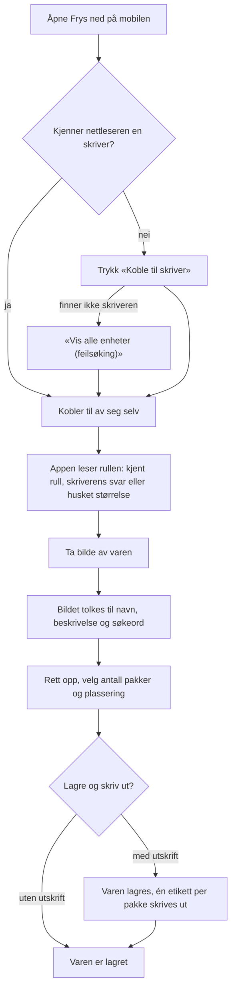
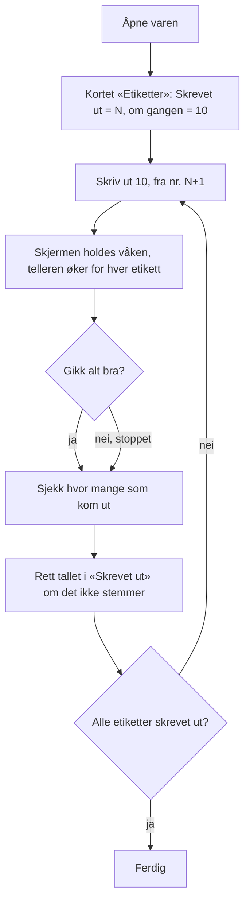
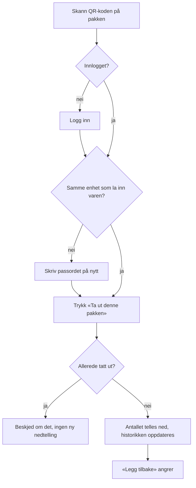
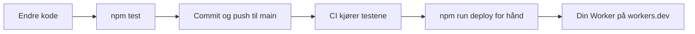

# Prosesskart

Oppdatert 5.11.2026. Kartene er skrevet i Mermaid og vises direkte på GitHub.

## Fra bilde til ferdig etikett («Frys ned»)

## Etiketter i omganger (varesiden)

«Print testetikett» i skriverkortet skriver én etikett uten å røre telleren, for å sjekke skriver og størrelse.

## Ta ut en pakke

## Endre og publisere (utvikling)

CI publiserer ikke; deploy gjøres for hånd. På en ny maskin må `npm install` kjøres først.
